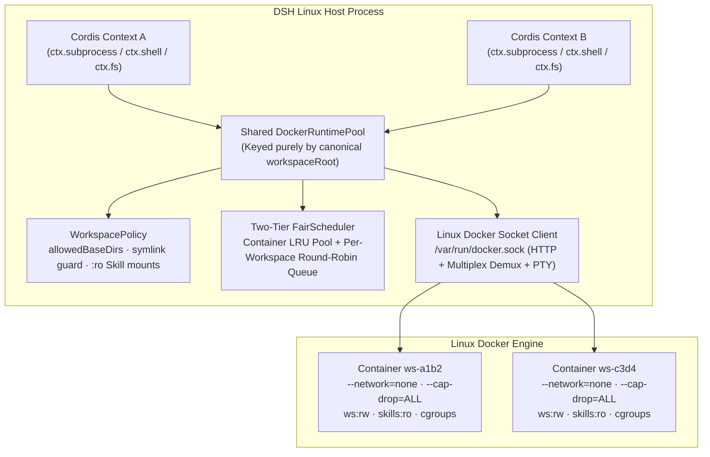

# dsh-cloud-sandbox

English | [简体中文](./README.zh.md)

**Linux & Windows WSL2 Docker execution-sandbox runtime plugin for DeepSeek Harness (`@deepseek-ai/dsh`).**

`dsh-cloud-sandbox` isolates agent commands, interactive terminals, and user-loaded Skill scripts inside hardened Linux Docker containers — managed purely by **working directory** (zero user-account coupling), with **host-wide concurrency limits and per-workspace fair queuing** built for cloud multi-tenant deployments (supporting native Linux `/var/run/docker.sock`, Windows Docker Desktop WSL2 named pipe `\\.\pipe\docker_engine`, and direct Windows -> WSL2 Docker Engine bridging via `wsl.exe`).

## Why This Plugin Exists

DeepSeek Harness's default local sandbox (`@deepseek-ai/dsh-sandbox-local`) enforces same-world host confinement (`bwrap` / `Landlock`). In shared Linux cloud deployments where users upload custom Skills with scripts:

- Host-level `bwrap` shares the host network and breaks inside nested containers;
- `@deepseek-ai/dsh-fs-sandbox` only restricts file writes (reads pass through);
- There is no per-workspace CPU/RAM/PID quota, container pool, or multi-tenant fair concurrency queue.

`dsh-cloud-sandbox` implements DSH's standard capability seams (`ctx.subprocess`, optional `ctx.shell`, optional `ctx.fs`) directly over the Linux Docker Engine Unix socket (`/var/run/docker.sock`) with **zero external runtime dependencies**.

## Architecture



## Key Features

- **User-Agnostic Workspace Isolation**: Keyed solely by `workspaceId = sha256(realpath(workspaceRoot))`. Works identically in vanilla DSH (single `Context`) and multi-context cloud Host servers (multiple isolated `Context` instances sharing one host-level `DockerRuntimePool`).
- **Safe User Skill Execution**: Mounts `workspaceRoot` (`:rw` or `:ro`) and Skill directories strictly read-only (`:ro`). Never exposes sibling workspaces, `runtime/` databases, or host secrets (`KEY|PASSWORD|SECRET|TOKEN`, `DSH_*`).
- **Two-Tier Cloud Concurrency & Fair Queuing**:
  - **Container pool (`maxActiveContainers`)** with automatic **LRU eviction** of idle containers and idle TTL reaping (`idleTtlMs`);
  - **Task pool (`maxConcurrentTasks` + `maxConcurrencyPerWorkspace`)** with **Per-Workspace Round-Robin Fair Queue** so one noisy workspace cannot starve others;
  - **Separate PTY terminal quota** so idle terminals never block short exec tasks;
  - Full `AbortSignal` queue cancellation, `maxQueueSize` fast-fail, `queueTimeoutMs`, and live observability metrics.
- **Hardened Linux Defaults**: `CapDrop: ['ALL']`, `no-new-privileges:true`, `ReadonlyRootfs: true`, bounded `/tmp` tmpfs, non-root `User`, CPU/memory/PIDs cgroup caps, `NetworkMode: 'none'` by default, and optional OCI runtime (`runsc` / gVisor).
- **Latest DSH Compatibility**: Peer-compatible with `@deepseek-ai/dsh` `>=0.2.1-rc.2` (including `0.2.2-rc.5` and `0.2.3-alpha`).

## Quick Start

### 1. Build the Default Runtime Image (Linux)

```bash
docker build -t dsh-cloud-sandbox-runtime:latest .
```

### 1.5. Install Directly as a DSH Plugin Bundle

`dsh-cloud-sandbox` declares `dsh.bundle.patch` (`./cordis.patch.yml`), icon, and localized metadata, so it can be installed directly via DSH's Plugin Manager UI or `dsh plugin add <path-or-package>` (after running `pnpm run build` for local checkouts).

- **Local Desktop / Web mode (default)**: Automatically trusts workspaces registered in DSH's `workspaceRegistry`, mounts existing user Skill directories (`~/.agents/skills`, `~/.dsh/skills`) read-only, enables `networkMode: bridge` for runtime `pip3`/`npm` installs, stages uploaded session attachments into `<workspaceRoot>/.dsh-uploads/`, and exposes the user-approval-gated `sandbox_import_file` tool (protected by `ctx.approval` + sensitive/credential path denylists) for importing specific host files as safe copies.
- **Multi-Tenant Cloud lockdown (`DSH_SANDBOX_CLOUD_MODE=1`)**: Disables `trustRegisteredWorkspaces`, `mountUserSkills`, `allowApprovedHostReadOnly`, and `sandbox_import_file`, defaults `networkMode` to `'none'`, and keeps strict static `allowedBaseDirs` + per-session isolated attachment staging into `<workspaceRoot>/.dsh-uploads/`. For cloud deployments that need public Internet access (while blocking LAN, cloud metadata `169.254.169.254`, host ports, and container-to-container traffic), run `sudo bash deploy/setup-public-egress-network.sh` (see [`deploy/README.md`](./deploy/README.md)) and set `DSH_SANDBOX_NETWORK_MODE=dsh-sandbox-public`.
- **Environment variables**: `DSH_SANDBOX_IMAGE`, `DSH_SANDBOX_TRANSPORT`, `DSH_SANDBOX_LIFECYCLE`, `DSH_SANDBOX_ALLOWED_DIRS` (comma-separated), `DSH_SANDBOX_RO_MOUNTS` (comma-separated), `DSH_SANDBOX_NETWORK_MODE` (defaults to `bridge` locally and `none` when `DSH_SANDBOX_CLOUD_MODE=1`; set `dsh-sandbox-public` for No-LAN cloud public egress), `DSH_SANDBOX_CLOUD_MODE=1`, `DSH_SANDBOX_HOST_IMPORT=0`.

### 2. Standalone DSH Integration (Single Context)

```ts
import { Context } from '@deepseek-ai/cordis'
import { DockerSubprocessRuntime, DockerShellExecutor, WorkspaceFencedFileSystem } from 'dsh-cloud-sandbox'

const ctx = new Context()

await ctx.plugin(DockerSubprocessRuntime, {
  image: 'dsh-cloud-sandbox-runtime:latest',
  workspace: {
    allowedBaseDirs: ['/srv/dsh/workspaces'],
    readOnlyMounts: ['/opt/dsh/skills'],
    pathMode: 'mirror',
  },
  scheduler: {
    maxActiveContainers: 20,
    maxConcurrentTasks: 12,
    maxConcurrencyPerWorkspace: 3,
    maxQueueSize: 100,
    queueTimeoutMs: 60_000,
    idleTtlMs: 15 * 60_000,
  },
  security: {
    networkMode: 'none',
    cpus: 2,
    memoryBytes: 2 * 1024 * 1024 * 1024,
    pidsLimit: 256,
  },
})

// Optional: enforce ctx.sandboxPolicy without danger-full-access escalation
await ctx.plugin(DockerShellExecutor, { allowDangerFullAccess: false })

// Optional (for vanilla DSH without custom UserFileSystem): strict read+write workspace fence
await ctx.plugin(WorkspaceFencedFileSystem, {
  allowedBaseDirs: ['/srv/dsh/workspaces'],
  readOnlyMounts: ['/opt/dsh/skills'],
})
```

### 3. Multi-Context Cloud Host Integration

Share **one** host-level `DockerRuntimePool` across every isolated Cordis `Context` so concurrency limits and fair queuing operate globally across the Linux host while keeping this plugin 100% user-agnostic:

```ts
import { createDockerRuntimePool, DockerSubprocessRuntime, DockerShellExecutor } from 'dsh-cloud-sandbox'

// Once at Host startup (root level):
const dockerPool = createDockerRuntimePool({
  image: 'dsh-cloud-sandbox-runtime:latest',
  workspace: {
    allowedBaseDirs: ['/var/lib/dsh/workspaces'],
    pathMode: 'mirror',
    // Dynamically mount only that workspace's associated skills directory as :ro
    resolveReadOnlyMounts: (workspaceRoot) => {
      // e.g. map /var/lib/dsh/workspaces/<ws> -> associated read-only skills directory
      return [/* validated absolute path to skills dir */]
    },
  },
  scheduler: {
    maxActiveContainers: 32,
    maxConcurrentTasks: 16,
    maxConcurrencyPerWorkspace: 2,
    maxQueueSize: 128,
    queueTimeoutMs: 120_000,
  },
})
await dockerPool.initialize()

// Inside each isolated Cordis Context:
await ctx.plugin(DockerSubprocessRuntime, { pool: dockerPool, ownPool: false })
await ctx.plugin(DockerShellExecutor, { allowDangerFullAccess: false })
```

## Windows + WSL2 Support

`dsh-cloud-sandbox` supports all three Windows/WSL2 setups with zero external dependencies:

1. **Running DSH inside WSL2 Linux**: Works identically to native Linux via `/var/run/docker.sock`.
2. **Running DSH natively on Windows with Docker Desktop (WSL2 backend)**: `transport: 'auto'` (or `'npipe'`) connects directly to `\\.\pipe\docker_engine`, translates Windows drive paths (`D:\work\ws1`) and WSL UNC paths (`\\wsl.localhost\Ubuntu\...`) into POSIX container paths (`/mnt/d/work/ws1`), and uses structured `HostConfig.Mounts` to avoid drive-letter colon ambiguity.
3. **Running DSH natively on Windows with Docker Engine inside WSL2 (no Docker Desktop)**: Set `transport: 'wsl'` (or configure `wsl: { distro: 'Ubuntu-24.04' }`, or rely on `transport: 'auto'` fallback). The plugin bridges `node:http` directly to `/var/run/docker.sock` inside WSL2 over `wsl.exe` (`socat` → `python3` → `node` auto-fallback) with no open TCP ports:

```ts
const dockerPool = createDockerRuntimePool({
  image: 'dsh-cloud-sandbox-runtime:latest',
  transport: 'wsl',
  wsl: {
    distro: 'Ubuntu-24.04', // optional: omit for default WSL2 distro
    socketPath: '/var/run/docker.sock',
    mountPrefix: '/mnt',
  },
  workspace: {
    allowedBaseDirs: ['D:\\workspaces'],
    readOnlyMounts: ['D:\\skills'],
  },
})
await dockerPool.initialize()
```

## Development & Verification

```bash
pnpm install
pnpm run check   # typecheck + vitest + build
```

## Documentation

- [README.zh.md](./README.zh.md) — 简体中文文档
- [AGENTS.md](./AGENTS.md) — Engineering invariants, layout, and agent guidelines
- [SECURITY.md](./SECURITY.md) — Threat model, container hardening, and Skill vs. Plugin boundaries
- [CONTRIBUTING.md](./CONTRIBUTING.md) — Contributor workflow and PR checklist
- [CHANGELOG.md](./CHANGELOG.md) — Version history

## License

Licensed under the [Apache License 2.0](./LICENSE).
