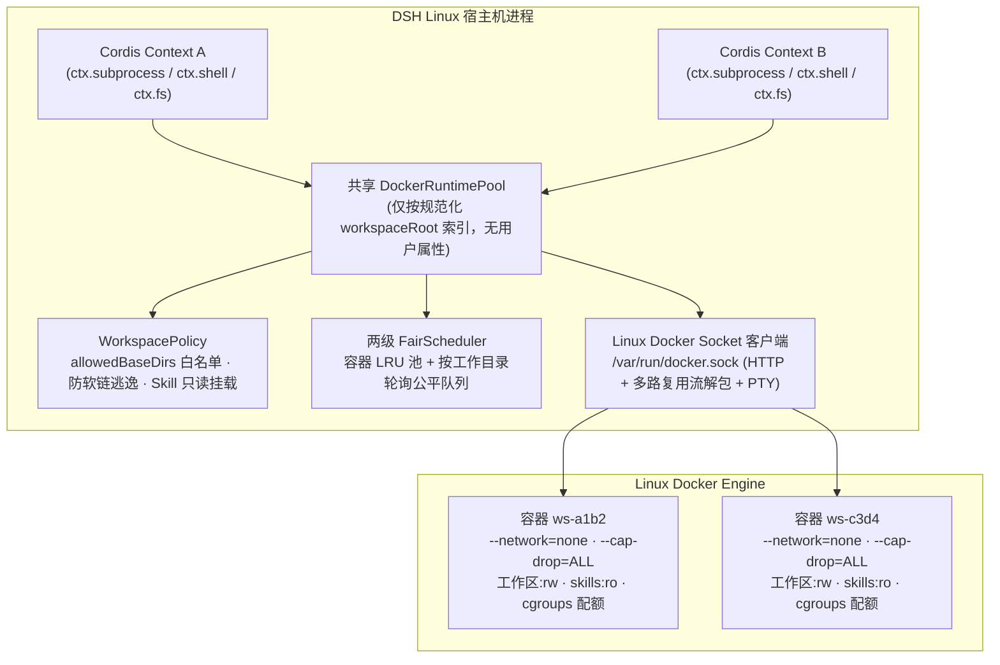

# dsh-cloud-sandbox

[English](./README.md) | 简体中文

**面向 DeepSeek Harness（`@deepseek-ai/dsh`）的云端 Linux Docker 执行沙盒插件。**

`dsh-cloud-sandbox` 将 Agent 的命令执行、交互式终端以及用户自定义 Skill 中的脚本隔离运行在加固的 Linux Docker 容器内——**仅按工作目录（`workspaceRoot`）管理、完全无用户属性**，并内置面向云端多人共享部署的**宿主机级并发限流与按工作目录公平排队调度**。

## 为什么需要这个插件

DeepSeek Harness 默认的本地沙盒（`@deepseek-ai/dsh-sandbox-local`）属于同宿主机内核约束（Linux 下基于 `bwrap` / `Landlock`）。在云端多人共用 Linux 服务器的场景下（尤其是开放用户上传自定义 Skill 及其脚本时）：

- 宿主机级 `bwrap` 共享宿主机网络，且当 DSH 本身运行在容器内时嵌套 `bwrap` / `Landlock` 容易触发 `SANDBOX_UNAVAILABLE`；
- 官方 `@deepseek-ai/dsh-fs-sandbox` 仅限制写操作，默认放行宿主机任意文件读取；
- 缺少按工作目录的 CPU / 内存 / PIDs 硬配额、容器复用池以及多人并发排队调度机制。

`dsh-cloud-sandbox` 直接实现 DSH 的标准能力接缝（`ctx.subprocess`，以及可选的 `ctx.shell` 与 `ctx.fs`），基于 Node.js 内置模块直连 Linux Docker Engine Unix Socket（`/var/run/docker.sock`），**零外部运行时依赖**。

## 系统架构



## 核心特性

- **纯工作目录隔离（无用户属性）**：唯一主键为 `workspaceId = sha256(realpath(workspaceRoot))`，不耦合任何账号、Session 或租户模型。既可直接挂载到原生单 `Context` 的 DSH，也可在云端多 Context 宿主机服务中由多个隔离 `Context` 共享同一个宿主机级 `DockerRuntimePool`。
- **安全运行用户自定义 Skill**：精确挂载当前 `workspaceRoot`（`:rw` 或 `:ro`）以及关联的 Skill 目录（强制 **`:ro`** 只读挂载），绝不挂载同级其他工作区、敏感 `runtime/` 数据目录或宿主机系统目录；自动清洗宿主机敏感环境变量（`KEY|PASSWORD|SECRET|TOKEN` 与 `DSH_*`）。
- **两级云端并发限流与公平排队**：
  - **容器槽位池（`maxActiveContainers`）**：按工作目录复用驻留容器（毫秒级 `docker exec`），满槽位时自动 **LRU 驱逐空闲容器**，并按 `idleTtlMs` 后台回收超时空闲容器；
  - **任务并发池（`maxConcurrentTasks` + `maxConcurrencyPerWorkspace`）**：限制全局与单工作目录并发数，通过**按工作目录轮询的公平队列（Round-Robin Fair Queue）**防止单个高频工作目录饿死其他用户；
  - **独立 PTY 终端配额**：交互式终端与短任务槽位隔离，避免挂起的终端占满全局任务并发；
  - **完整取消与过载保护**：支持 `maxQueueSize` 快速失败、`queueTimeoutMs` 排队超时、`AbortSignal` 即时移出队列不泄漏槽位，以及实时队列指标/事件回调。
- **Linux 容器安全基线（Fail-Closed）**：默认强制开启 `CapDrop: ['ALL']`、`no-new-privileges:true`、`ReadonlyRootfs: true`、有界 `/tmp` tmpfs、非 root 用户（`1000:1000`）、CPU/内存/PIDs 配额、`NetworkMode: 'none'`（默认断网防 SSRF），并支持配置 `runtime: 'runsc'`（gVisor）等强隔离运行时。
- **兼容最新 DSH**：通过 `peerDependencies` 兼容 `@deepseek-ai/dsh` `>=0.2.1-rc.2`（包括最新 `0.2.2-rc.5` 与 `0.2.3-alpha`）。

## 快速开始

### 1. 构建默认 Linux 运行时镜像

```bash
docker build -t dsh-cloud-sandbox-runtime:latest .
```

### 2. 原生 DSH 单 Context 接入

```ts
import { Context } from '@deepseek-ai/cordis'
import { DockerSubprocessRuntime, DockerShellExecutor, WorkspaceFencedFileSystem } from 'dsh-cloud-sandbox'

const ctx = new Context()

await ctx.plugin(DockerSubprocessRuntime, {
  image: 'dsh-cloud-sandbox-runtime:latest',
  workspace: {
    allowedBaseDirs: ['/srv/dsh/workspaces'],
    readOnlyMounts: ['/opt/dsh/skills'],
    pathMode: 'mirror',
  },
  scheduler: {
    maxActiveContainers: 20,
    maxConcurrentTasks: 12,
    maxConcurrencyPerWorkspace: 3,
    maxQueueSize: 100,
    queueTimeoutMs: 60_000,
    idleTtlMs: 15 * 60_000,
  },
  security: {
    networkMode: 'none',
    cpus: 2,
    memoryBytes: 2 * 1024 * 1024 * 1024,
    pidsLimit: 256,
  },
})

// 可选：对接 ctx.sandboxPolicy，强制禁止提权至 danger-full-access
await ctx.plugin(DockerShellExecutor, { allowDangerFullAccess: false })

// 可选（原生 DSH 无自定义 UserFileSystem 时使用）：严格读写双围栏
await ctx.plugin(WorkspaceFencedFileSystem, {
  allowedBaseDirs: ['/srv/dsh/workspaces'],
  readOnlyMounts: ['/opt/dsh/skills'],
})
```

### 3. 云端多 Context 宿主机共享池接入

在 Host 启动阶段创建**唯一**的 `DockerRuntimePool`，并注入到每个独立 `Context` 中，从而在保持本插件零用户属性的同时实现全宿主机跨目录并发限流与公平排队：

```ts
import { createDockerRuntimePool, DockerSubprocessRuntime, DockerShellExecutor } from 'dsh-cloud-sandbox'

// Host 启动时创建一次（root 层级）：
const dockerPool = createDockerRuntimePool({
  image: 'dsh-cloud-sandbox-runtime:latest',
  workspace: {
    allowedBaseDirs: ['/var/lib/dsh/workspaces'],
    pathMode: 'mirror',
    // 动态仅以只读方式挂载当前工作区关联的 skills 目录（绝不暴露私有 runtime 目录）
    resolveReadOnlyMounts: (workspaceRoot) => {
      // 示例：将 /var/lib/dsh/workspaces/<ws> 映射到对应只读 skills 目录
      return [/* 校验后的只读技能目录绝对路径 */]
    },
  },
  scheduler: {
    maxActiveContainers: 32,
    maxConcurrentTasks: 16,
    maxConcurrencyPerWorkspace: 2,
    maxQueueSize: 128,
    queueTimeoutMs: 120_000,
  },
})
await dockerPool.initialize()

// 在每个独立的运行时 Context 中挂载薄适配器：
await ctx.plugin(DockerSubprocessRuntime, { pool: dockerPool, ownPool: false })
await ctx.plugin(DockerShellExecutor, { allowDangerFullAccess: false })
```

## 开发与验证

```bash
pnpm install
pnpm run check   # 类型检查 (typecheck) + 单元测试 (vitest) + 编译产物 (build)
```

## 相关文档

- [README.md](./README.md) — English documentation
- [AGENTS.md](./AGENTS.md) — 工程不变量、目录结构与 AI 协作开发规范
- [SECURITY.md](./SECURITY.md) — 威胁模型、容器安全加固基线与 Skill / Plugin 边界说明
- [CONTRIBUTING.md](./CONTRIBUTING.md) — 贡献指南与 PR 核对清单
- [CHANGELOG.md](./CHANGELOG.md) — 版本变更日志

## 开源协议

本项目基于 [Apache License 2.0](./LICENSE) 协议开源。
