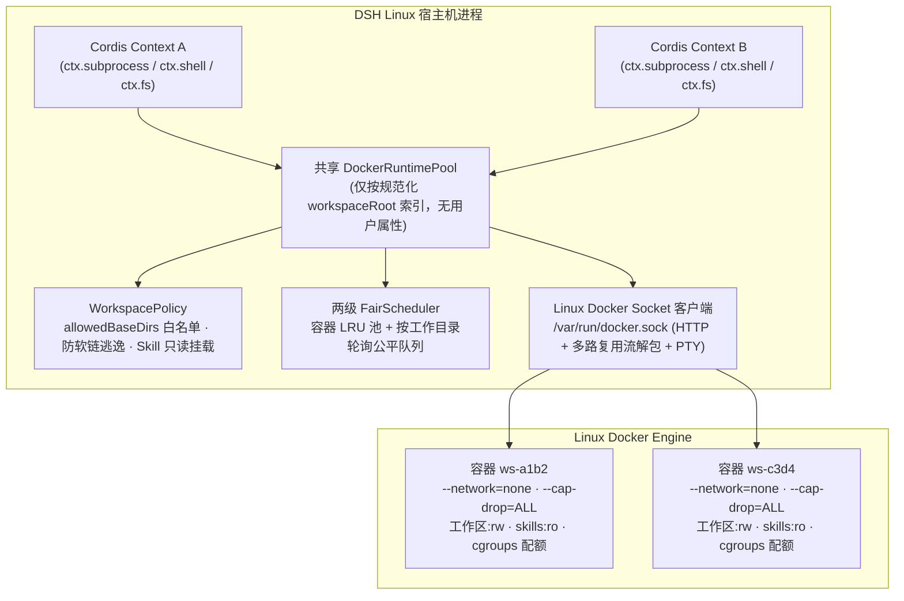

# dsh-cloud-sandbox

[English](./README.md) | 简体中文

**面向 DeepSeek Harness（`@deepseek-ai/dsh`）的云端 Linux & Windows WSL2 Docker 执行沙盒插件。**

`dsh-cloud-sandbox` 将 Agent 的命令执行、交互式终端以及用户自定义 Skill 中的脚本隔离运行在加固的 Linux Docker 容器内——**仅按工作目录（`workspaceRoot`）管理、完全无用户属性**，并内置面向云端多人共享部署的**宿主机级并发限流与按工作目录公平排队调度**（同时支持原生 Linux `/var/run/docker.sock`、Windows Docker Desktop WSL2 命名管道 `\\.\pipe\docker_engine`，以及无 Docker Desktop 时的原生 Windows → WSL2 Docker Engine 直连桥接）。

## 为什么需要这个插件

DeepSeek Harness 默认的本地沙盒（`@deepseek-ai/dsh-sandbox-local`）属于同宿主机内核约束（Linux 下基于 `bwrap` / `Landlock`）。在云端多人共用 Linux 服务器的场景下（尤其是开放用户上传自定义 Skill 及其脚本时）：

- 宿主机级 `bwrap` 共享宿主机网络，且当 DSH 本身运行在容器内时嵌套 `bwrap` / `Landlock` 容易触发 `SANDBOX_UNAVAILABLE`；
- 官方 `@deepseek-ai/dsh-fs-sandbox` 仅限制写操作，默认放行宿主机任意文件读取；
- 缺少按工作目录的 CPU / 内存 / PIDs 硬配额、容器复用池以及多人并发排队调度机制。

`dsh-cloud-sandbox` 直接实现 DSH 的标准能力接缝（`ctx.subprocess`，以及可选的 `ctx.shell` 与 `ctx.fs`），基于 Node.js 内置模块直连 Linux Docker Engine Unix Socket（`/var/run/docker.sock`），**零外部运行时依赖**。

## 系统架构



## 核心特性

- **纯工作目录隔离（无用户属性）**：唯一主键为 `workspaceId = sha256(realpath(workspaceRoot))`，不耦合任何账号、Session 或租户模型。既可直接挂载到原生单 `Context` 的 DSH，也可在云端多 Context 宿主机服务中由多个隔离 `Context` 共享同一个宿主机级 `DockerRuntimePool`。
- **安全运行用户自定义 Skill**：精确挂载当前 `workspaceRoot`（`:rw` 或 `:ro`）以及关联的 Skill 目录（强制 **`:ro`** 只读挂载），绝不挂载同级其他工作区、敏感 `runtime/` 数据目录或宿主机系统目录；自动清洗宿主机敏感环境变量（`KEY|PASSWORD|SECRET|TOKEN` 与 `DSH_*`）。
- **两级云端并发限流与公平排队**：
  - **容器槽位池（`maxActiveContainers`）**：按工作目录复用驻留容器（毫秒级 `docker exec`），满槽位时自动 **LRU 驱逐空闲容器**，并按 `idleTtlMs` 后台回收超时空闲容器；
  - **任务并发池（`maxConcurrentTasks` + `maxConcurrencyPerWorkspace`）**：限制全局与单工作目录并发数，通过**按工作目录轮询的公平队列（Round-Robin Fair Queue）**防止单个高频工作目录饿死其他用户；
  - **独立 PTY 终端配额**：交互式终端与短任务槽位隔离，避免挂起的终端占满全局任务并发；
  - **完整取消与过载保护**：支持 `maxQueueSize` 快速失败、`queueTimeoutMs` 排队超时、`AbortSignal` 即时移出队列不泄漏槽位，以及实时队列指标/事件回调。
- **Linux 容器安全基线（Fail-Closed）**：默认强制开启 `CapDrop: ['ALL']`、`no-new-privileges:true`、`ReadonlyRootfs: true`、有界 `/tmp` tmpfs、非 root 用户（`1000:1000`）、CPU/内存/PIDs 配额、`NetworkMode: 'none'`（默认断网防 SSRF），并支持配置 `runtime: 'runsc'`（gVisor）等强隔离运行时。
- **兼容最新 DSH**：通过 `peerDependencies` 兼容 `@deepseek-ai/dsh` `>=0.2.1-rc.2`（包括最新 `0.2.2-rc.5` 与 `0.2.3-alpha`）。

## 快速开始

### 1. 安装 DSH 组合包插件

`dsh-cloud-sandbox` 已声明 `dsh.bundle.patch`（`./cordis.patch.yml`）、图标与中英文元数据，可直接通过 DSH 插件管理器 UI 或 `dsh plugin add <本地目录或包名>` 安装（本地目录安装前需先执行 `pnpm run build` 生成 `dist/`）。

在插件管理器中填写 npm 包名 `dsh-cloud-sandbox`，或通过命令行安装预编译包：

```bash
dsh plugin --profile desktop add dsh-cloud-sandbox
```

Web 模式将 `desktop` 换为 `web`。GitHub Release 也提供预编译包，插件管理器可填写以下地址：

```text
https://github.com/dengmuming/dsh-cloud-sandbox.git#dist
```

`dist` 指向最新稳定版。锁定版本时，将 `#dist` 换为 `#dist-v<版本号>`；也可安装该版本 Release 附带的 `dsh-cloud-sandbox-<版本号>.tgz` 下载链接。`main` 和 `v*` 源码 tag 不包含 `dist/`，不适合直接安装。沙箱 Docker 镜像仍需单独构建。

先启动 Docker：Windows Docker Desktop 使用 Linux 容器模式；Linux / WSL2 启动对应的 Docker Engine。安装插件后，完成下面的镜像构建，再开始使用沙箱。

- **本机 Desktop / Web 模式（默认）**：自动信任 DSH `workspaceRegistry` 中已注册的工作区、自动只读挂载 `~/.agents/skills` 与 `~/.dsh/skills`、默认开启 `networkMode: bridge` 以便容器内按需 `pip3`/`npm` 装包、自动将当前会话上传的文件投递至 `<workspaceRoot>/.dsh-uploads/`，并提供受 DSH 原生审批（`ctx.approval`）与敏感/凭据路径黑名单双门禁保护的 `sandbox_import_file` 工具，经用户点击允许后将宿主机文件安全拷贝入沙箱。
- **云端多租户锁定模式（`DSH_SANDBOX_CLOUD_MODE=1`）**：自动关闭 `trustRegisteredWorkspaces`、`mountUserSkills`、`allowApprovedHostReadOnly` 与 `sandbox_import_file`，默认 `networkMode: none`，仅保留静态 `allowedBaseDirs` 白名单与按会话隔离的 `.dsh-uploads/` 附件投递。若云端需要**封死内网、放通公网**（屏蔽内网段、云元数据 `169.254.169.254`、宿主机端口与容器互访），在 Linux 宿主机执行 `sudo bash deploy/setup-public-egress-network.sh`（详见 [`deploy/README.md`](./deploy/README.md)）并设置 `DSH_SANDBOX_NETWORK_MODE=dsh-sandbox-public`。
- **常用环境变量**：`DSH_SANDBOX_IMAGE`、`DSH_SANDBOX_TRANSPORT`、`DSH_SANDBOX_LIFECYCLE`、`DSH_SANDBOX_ALLOWED_DIRS`（逗号分隔）、`DSH_SANDBOX_RO_MOUNTS`（逗号分隔）、`DSH_SANDBOX_NETWORK_MODE`（本地默认 `bridge`，云端 `DSH_SANDBOX_CLOUD_MODE=1` 默认 `none`，云端封内网放公网可设为 `dsh-sandbox-public`）、`DSH_SANDBOX_CLOUD_MODE=1`、`DSH_SANDBOX_HOST_IMPORT=0`。

### 2. 从插件安装目录构建沙箱镜像

构建命令最后一个参数必须指向包含 `Dockerfile` 的目录。安装包已经包含 `Dockerfile`，下面的命令可在任意当前目录执行。

**Windows Desktop — CMD：**

```cmd
docker build -t dsh-cloud-sandbox-runtime:latest "%USERPROFILE%\.dsh\profiles\desktop\node_modules\dsh-cloud-sandbox"
```

**Windows Desktop — PowerShell：**

```powershell
docker build -t dsh-cloud-sandbox-runtime:latest "$env:USERPROFILE\.dsh\profiles\desktop\node_modules\dsh-cloud-sandbox"
```

**Linux / WSL2 内运行的 DSH Web — Bash：**

```bash
docker build -t dsh-cloud-sandbox-runtime:latest "${DSH_HOME:-$HOME/.dsh}/profiles/web/node_modules/dsh-cloud-sandbox"
```

这些路径使用默认的 DSH home 和 profile：Desktop 为 `desktop`，Web 为 `web`。使用其他 profile 时替换目录名；Windows 配置了 `DSH_HOME` 时，将 `%USERPROFILE%\.dsh` 或 `$env:USERPROFILE\.dsh` 替换为实际目录。先确认该目录内存在 `Dockerfile`。Windows DSH 连接纯 WSL2 Docker Engine 时，应在对应的 WSL 发行版中构建，并使用 Windows 插件安装目录映射后的 POSIX 路径。构建所用的 Docker Engine 必须与插件连接的 Engine 一致。

**从源码构建镜像：**

```bash
git clone https://github.com/dengmuming/dsh-cloud-sandbox.git
cd dsh-cloud-sandbox
docker build -t dsh-cloud-sandbox-runtime:latest .
```

只有在包含 `Dockerfile` 的源码目录内执行时，才使用末尾的 `.`；它表示当前目录。若看到 `open Dockerfile: no such file or directory`，请改用上面的插件安装目录，或先切换到源码目录。

构建完成后验证镜像存在：

```bash
docker image inspect dsh-cloud-sandbox-runtime:latest
```

命令成功后，在 DSH 中启用插件；若之前启用失败，重新启用或重启 DSH。

### 3. 原生 DSH 单 Context 接入

```ts
import { Context } from '@deepseek-ai/cordis'
import { DockerSubprocessRuntime, DockerShellExecutor, WorkspaceFencedFileSystem } from 'dsh-cloud-sandbox'

const ctx = new Context()

await ctx.plugin(DockerSubprocessRuntime, {
  image: 'dsh-cloud-sandbox-runtime:latest',
  workspace: {
    allowedBaseDirs: ['/srv/dsh/workspaces'],
    readOnlyMounts: ['/opt/dsh/skills'],
    pathMode: 'mirror',
  },
  scheduler: {
    maxActiveContainers: 20,
    maxConcurrentTasks: 12,
    maxConcurrencyPerWorkspace: 3,
    maxQueueSize: 100,
    queueTimeoutMs: 60_000,
    idleTtlMs: 15 * 60_000,
  },
  security: {
    networkMode: 'none',
    cpus: 2,
    memoryBytes: 2 * 1024 * 1024 * 1024,
    pidsLimit: 256,
  },
})

// 可选：对接 ctx.sandboxPolicy，强制禁止提权至 danger-full-access
await ctx.plugin(DockerShellExecutor, { allowDangerFullAccess: false })

// 可选（原生 DSH 无自定义 UserFileSystem 时使用）：严格读写双围栏
await ctx.plugin(WorkspaceFencedFileSystem, {
  allowedBaseDirs: ['/srv/dsh/workspaces'],
  readOnlyMounts: ['/opt/dsh/skills'],
})
```

### 4. 云端多 Context 宿主机共享池接入

在 Host 启动阶段创建**唯一**的 `DockerRuntimePool`，并注入到每个独立 `Context` 中，从而在保持本插件零用户属性的同时实现全宿主机跨目录并发限流与公平排队：

```ts
import { createDockerRuntimePool, DockerSubprocessRuntime, DockerShellExecutor } from 'dsh-cloud-sandbox'

// Host 启动时创建一次（root 层级）：
const dockerPool = createDockerRuntimePool({
  image: 'dsh-cloud-sandbox-runtime:latest',
  workspace: {
    allowedBaseDirs: ['/var/lib/dsh/workspaces'],
    pathMode: 'mirror',
    // 动态仅以只读方式挂载当前工作区关联的 skills 目录（绝不暴露私有 runtime 目录）
    resolveReadOnlyMounts: (workspaceRoot) => {
      // 示例：将 /var/lib/dsh/workspaces/<ws> 映射到对应只读 skills 目录
      return [/* 校验后的只读技能目录绝对路径 */]
    },
  },
  scheduler: {
    maxActiveContainers: 32,
    maxConcurrentTasks: 16,
    maxConcurrencyPerWorkspace: 2,
    maxQueueSize: 128,
    queueTimeoutMs: 120_000,
  },
})
await dockerPool.initialize()

// 在每个独立的运行时 Context 中挂载薄适配器：
await ctx.plugin(DockerSubprocessRuntime, { pool: dockerPool, ownPool: false })
await ctx.plugin(DockerShellExecutor, { allowDangerFullAccess: false })
```

## Windows + WSL2 支持

本插件零外部依赖支持全部三种 Windows / WSL2 运行拓扑：

1. **DSH 直接运行在 WSL2 Linux 内**：与原生 Linux 完全一致，直连 `/var/run/docker.sock`。
2. **DSH 原生运行在 Windows + Docker Desktop（WSL2 后端）**：`transport: 'auto'`（或 `'npipe'`）直连命名管道 `\\.\pipe\docker_engine`，自动把 Windows 盘符路径（`D:\work\ws1`）和 WSL UNC 路径（`\\wsl.localhost\Ubuntu\...`）映射为容器内合法 POSIX 路径（`/mnt/d/work/ws1`），并通过结构化 `HostConfig.Mounts` 规避盘符冒号解析冲突。
3. **DSH 原生运行在 Windows + 纯 WSL2 内 Docker Engine（无需 Docker Desktop）**：设置 `transport: 'wsl'`（或配置 `wsl: { distro: 'Ubuntu-24.04' }`，或依赖 `transport: 'auto'` 自动回退），通过 `wsl.exe` 零 TCP 端口直连 WSL2 内部的 `/var/run/docker.sock`（自动按 `socat` → `python3` → `node` 探测桥接工具）：

```ts
const dockerPool = createDockerRuntimePool({
  image: 'dsh-cloud-sandbox-runtime:latest',
  transport: 'wsl',
  wsl: {
    distro: 'Ubuntu-24.04', // 可选，不填则使用默认 WSL2 发行版
    socketPath: '/var/run/docker.sock',
    mountPrefix: '/mnt',
  },
  workspace: {
    allowedBaseDirs: ['D:\\workspaces'],
    readOnlyMounts: ['D:\\skills'],
  },
})
await dockerPool.initialize()
```

## 开发与验证

```bash
pnpm install
pnpm run check   # 类型检查 (typecheck) + 单元测试 (vitest) + 编译产物 (build)
```

### GitHub Actions 发布

分支 push（不含 `dist`）和 PR 自动运行 `pnpm run check`。发布时先更新 `package.json` 版本与 CHANGELOG，提交到 `main`，再推送完全匹配包版本的 `v<版本号>` tag：

```bash
git tag v<版本号>
git push origin v<版本号>
```

Release 工作流检出该 tag、安装锁定依赖、运行全部检查，并验证打包后的入口和资源文件，再上传 `.tgz`、创建 `dist-v<版本号>` tag。只有更新的稳定版会更新 `dist` 分支；预发布版和旧版本补发不会覆盖它。已存在的 `dist-v*` tag 内容不可更改。失败后可重跑任务，也可在 Actions → Release → Run workflow 填写已存在的源码 tag 补发。工作流已声明 `contents: write`，无需扩大仓库默认 token 权限；仓库须允许运行 GitHub Actions，并允许该工作流写入 `dist` 分支和 tag。

## 相关文档

- [发布与市场收录](https://github.com/dengmuming/dsh-cloud-sandbox/blob/main/docs/publishing.md) — npm 发布身份、自动发布和社区索引条目
- [README.md](./README.md) — English documentation
- [AGENTS.md](./AGENTS.md) — 工程不变量、目录结构与 AI 协作开发规范
- [SECURITY.md](./SECURITY.md) — 威胁模型、容器安全加固基线与 Skill / Plugin 边界说明
- [CONTRIBUTING.md](./CONTRIBUTING.md) — 贡献指南与 PR 核对清单
- [CHANGELOG.md](./CHANGELOG.md) — 版本变更日志

## 开源协议

本项目基于 [Apache License 2.0](./LICENSE) 协议开源。
